# Ubuntu for the Galaxy Tab Active2 LTE (SM-T395, Exynos 7870)

**Give an old rugged tablet a second life as a tiny home server with a touch screen.**

The Samsung Galaxy Tab Active2 (2017) is stuck on Android 9 and too slow for today's apps. But it is a fanless
8-core ARM64 computer with 3 GB of RAM, Wi-Fi, a built-in UPS (its battery), an IP68 case and a screen.
This repo turns it into **Ubuntu Server Mini**: native Ubuntu 24.04, no Android underneath,
Docker, file sharing, a touch control panel on the device and a web dashboard for your phone or PC.

| | **Ubuntu Server Mini** (recommended) | **Ubuntu Touch** (alpha) |
|---|---|---|
| What it is | Ubuntu 24.04 server + touch launcher + web dashboard | Full phone/tablet shell (Lomiri) on Halium 13 |
| Android inside | **No.** Native Linux | Yes, an Android 13 container for the hardware |
| RAM used after boot | **~300 MB** (home screen + file sharing + Docker) | ~1.3 GB |
| Boot time | **~15 s** | ~25 s |
| Use it for | Docker host, NAS, Pi-hole, Home Assistant, wall dashboard | Touch tablet, calls/SMS, apps |
| Folder | [`server-mini/`](server-mini/README.md) | [`ubuntu-touch/`](ubuntu-touch/README.md) |

> Looking for Android? See **[LineageOS 20 (Android 13) OC edition](https://github.com/ttabouch12/LineageOS-20-Galaxy-Tab-Active2-SM-T395)**.
> That is also the way back to Android from either build here.

---

## Ubuntu Server Mini 1.3

| Home | Settings | Wi-Fi | Keyboard |
|---|---|---|---|
| 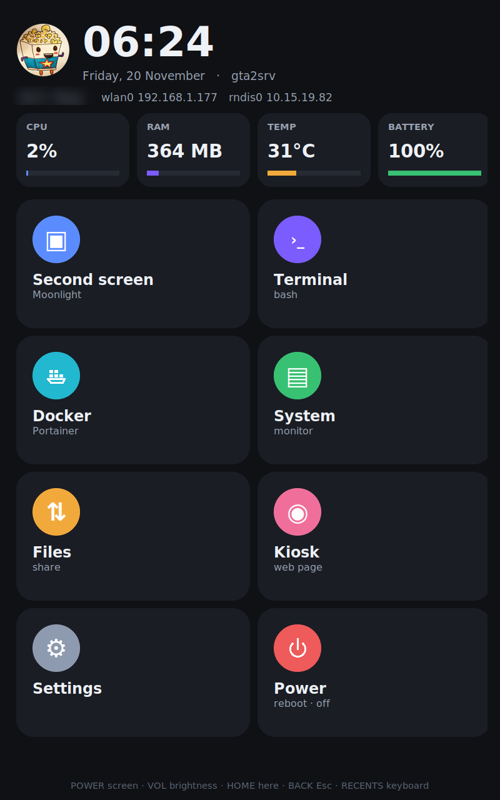 | 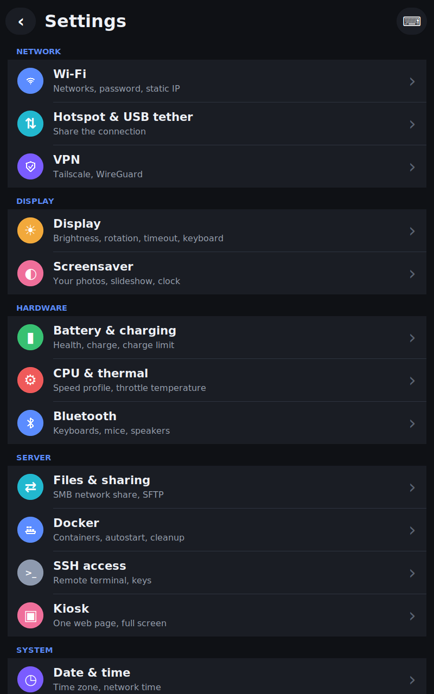 | 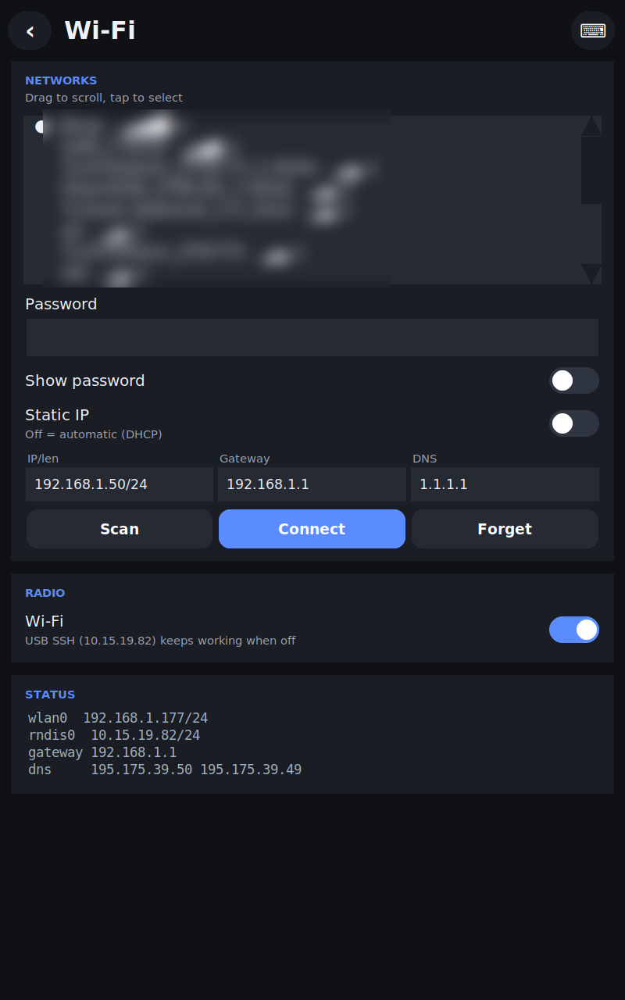 | 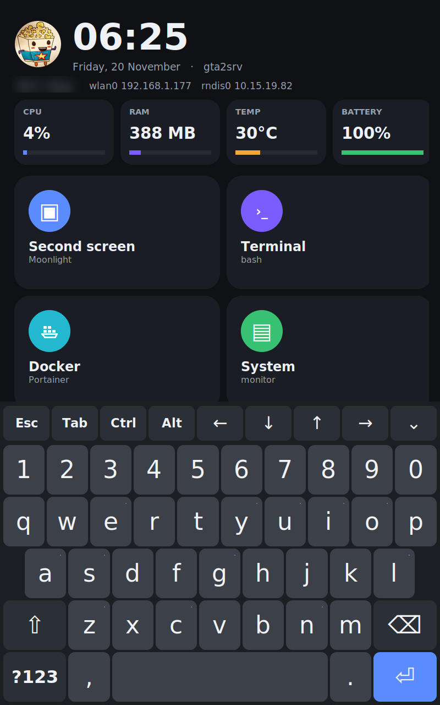 |

| Display | Battery & charge limit | CPU | System monitor |
|---|---|---|---|
| 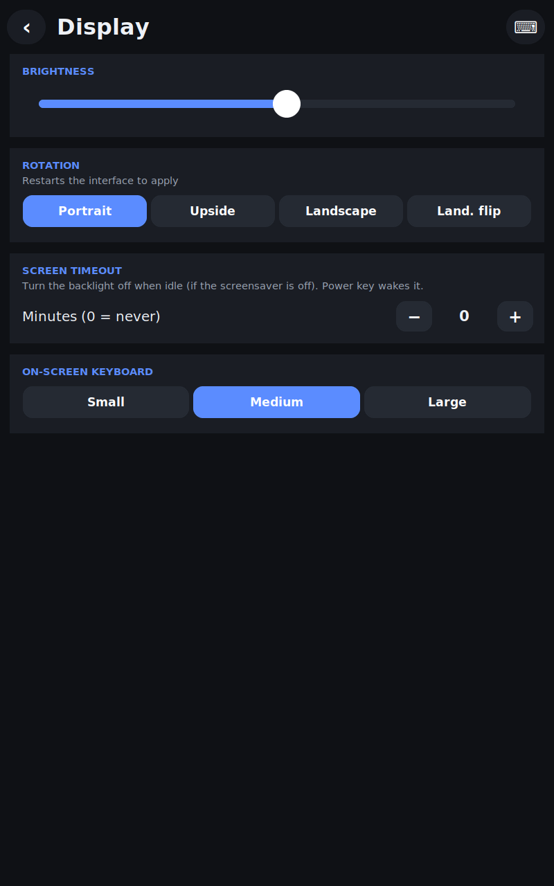 | 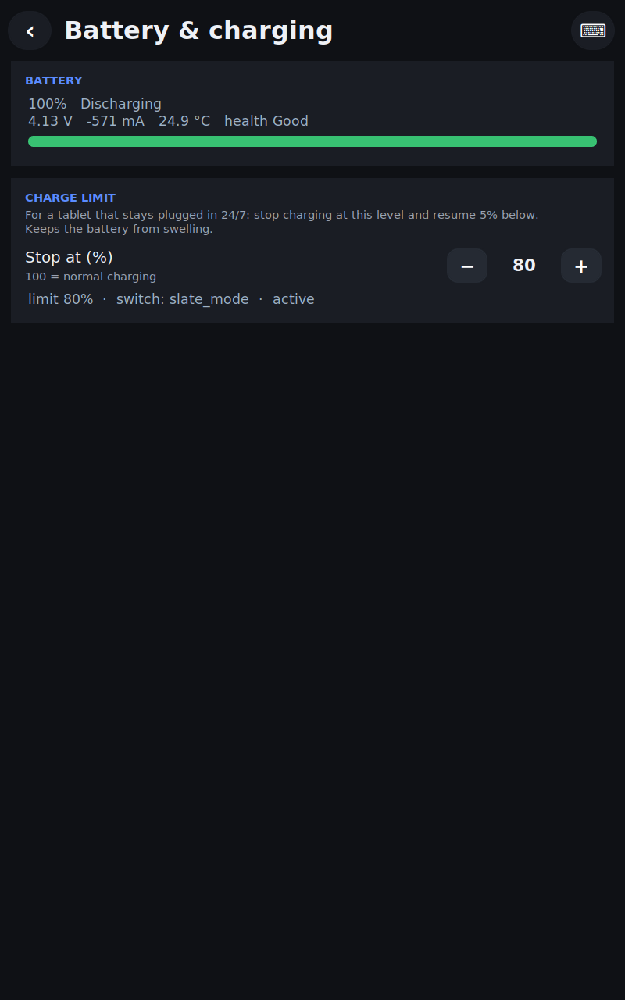 | 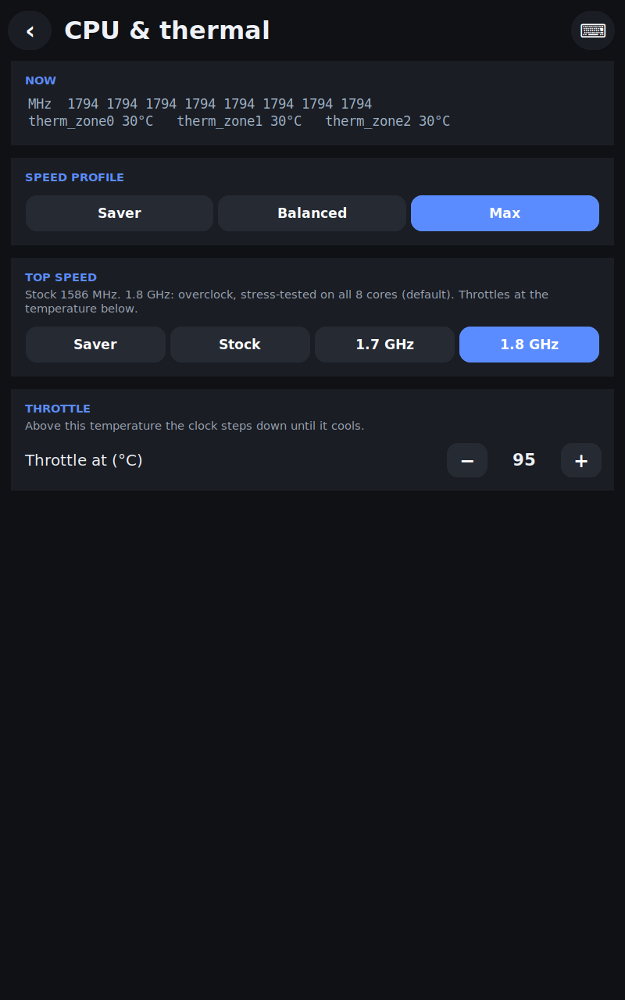 | 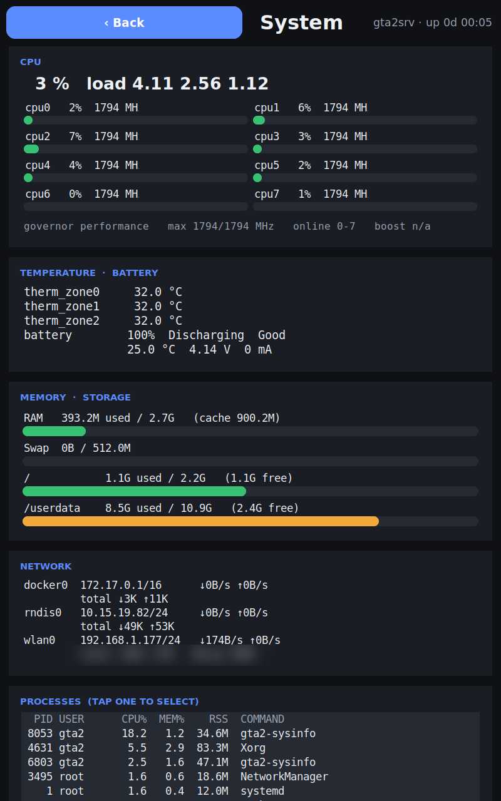 |

| Web dashboard (phone/PC) | App store | Docker | File sharing |
|---|---|---|---|
| 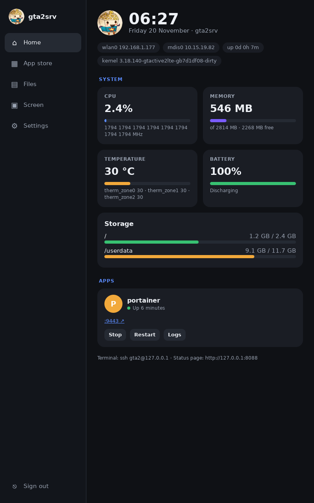 | 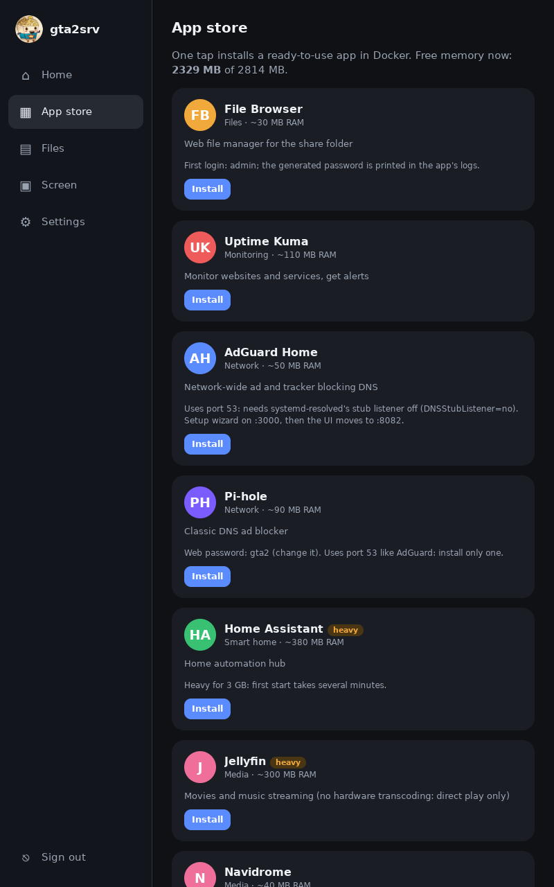 | 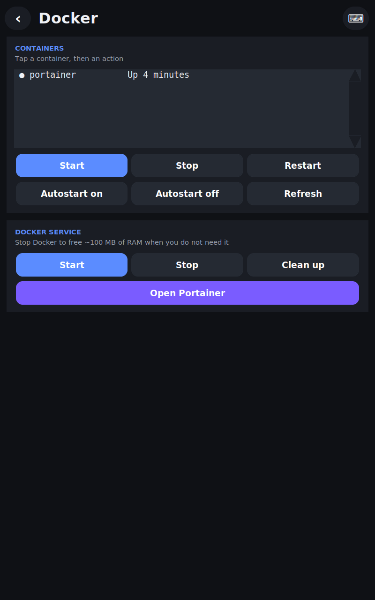 | 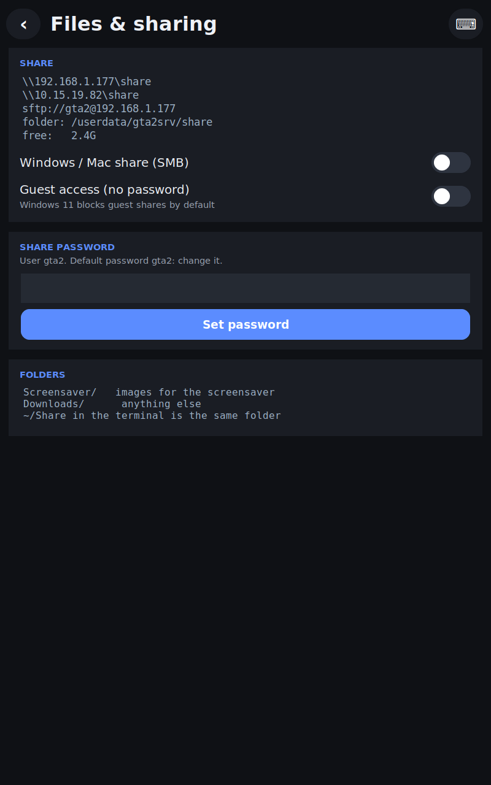 |

### What people can do with an old tablet like this

| Use case | How, with this build |
|---|---|
| **Ad blocker for the whole house** | App store → *Pi-hole* or *AdGuard Home*, point your router's DNS at the tablet. |
| **Smart-home hub with a wall screen** | App store → *Home Assistant*; Settings → Kiosk shows its dashboard full screen at boot. The battery keeps it running through power cuts. |
| **Small NAS / backup target** | Built-in SMB share (`\\tablet\share`, shows up in Windows' *Network*), SFTP, *Syncthing* for phone photo backup, microSD card for extra space. |
| **Media server** | *Jellyfin* (music, light video) or *Navidrome* (music streaming to your phone). |
| **Password manager** | *Vaultwarden* (Bitwarden compatible) on your own hardware, reachable everywhere with *Tailscale*. |
| **Uptime / network monitor** | *Uptime Kuma* + the live status page on `:8088` on the tablet's screen. |
| **Downloads box** | *Transmission* / *qBittorrent* writing straight to the share. |
| **Git server, automations** | *Gitea*, *Node-RED*, *Mosquitto* (MQTT) for ESP32/IoT projects. |
| **Second screen for a laptop** | Moonlight client tile (pair with Sunshine on the PC). |
| **Learning Linux/Docker** | A real always-on ARM64 Ubuntu box with SSH, for free, that fits in a drawer. |

Most of these apps need 30–150 MB of RAM each; the tablet has ~2.4 GB free, so several run at once.

### What's new in 1.3

* **Redesigned interface.** Rounded, anti-aliased cards, live CPU/RAM/temperature/battery tiles and a new home screen.
* **New keyboard, Gboard-style.** Esc/Tab/Ctrl/Alt/arrow strip, number row, `?123` and `=\<` layers, long-press for
  accents, key-repeat backspace, one-shot Shift or Caps lock, S/M/L sizes. It never steals the focus.
* **Settings v2:** a category list with these pages:

  | Group | Pages |
  |---|---|
  | Network | Wi-Fi, Hotspot & USB tether, VPN (Tailscale / WireGuard) |
  | Display | Brightness, rotation (portrait/landscape), screen timeout, keyboard size, screensaver |
  | Hardware | Battery (health, **charge limit** for 24/7 use), CPU (speed profile, throttle temperature), Bluetooth |
  | Server | File sharing, Docker (start/stop/autostart/cleanup), SSH (password login, keys), Kiosk |
  | System | Date & time zone, device name & password, Ubuntu updates & cleanup, power |
* **Web dashboard on port 80** (`http://<tablet-ip>/`, sign in with the `gta2` password). It is in the style of
  ZimaOS/CasaOS, but systemd starts it only when you open it and it exits after 10 idle minutes, so it uses **0 MB
  when nobody is looking**. Pages:
  * live stats, with your Docker apps as tiles linking to their web UIs;
  * an **app store** with one-click installs of 18 small arm64 apps;
  * a **file manager** for the share and the SD card;
  * a **live view of the tablet's screen that you can tap**;
  * **every setting** from the tablet.

  See [`server-mini/PANEL.md`](server-mini/PANEL.md).
* **microSD card:** mounted automatically on insert (`/media/sdcard`), visible as *SD card* in the share and the web
  file manager (FAT32, exFAT, NTFS, ext4). Not yet tested with a card in this release.
* **Bluetooth** page (BlueZ) for keyboards, mice and speakers: needs the mainline kernel (the 3.18 kernel's
  Bluetooth only works through Android).
* **Battery charge limit** (stop at e.g. 80 %, resume 5 % lower) so a tablet plugged in 24/7 doesn't swell.

### Install (about 5 minutes)

You need **TWRP** and the **LineageOS 20 OC ROM installed once** (linked above). Ubuntu Server Mini
reads the Wi-Fi firmware from that ROM's vendor partition, so flash LineageOS first if the tablet still
runs stock Samsung firmware.

1. Download the latest `ubuntu-server-mini-*.zip` from the [Releases](../../releases).
2. Boot TWRP (power off, then hold **Power + Volume Up**).
3. **Wipe > Format Data** and type `yes`. This erases the tablet, back up first.
4. Copy the zip to the tablet (`adb push`, MTP or a microSD card) and **Install** it.
5. **Reboot > System**. The home screen appears after about 20 seconds.

Default login: user **`gta2`**, password **`gta2`**. Change it right away (Settings → Device, or `passwd`).
Headless setup (SSH key and Wi-Fi without touching the screen): see [`server-mini/README.md`](server-mini/README.md).

Updating from 1.2: copy `server-mini/overlay/` over `/` (or reinstall the zip; your share, Docker data and apps in
`/data/gta2srv` are kept).

### Home screen and keys

| Key | Action |
|---|---|
| Power | screen off / on (backlight) |
| Volume up / down | brightness |
| Home | back to the home screen (also closes Portainer/kiosk, hides the keyboard) |
| Back | Esc |
| Recents | on-screen keyboard on / off |

### Two kernels

* **3.18 (default in the zip):** Samsung/LineageOS kernel, everything in the tables above works. CPU at 1.79 GHz on all
  8 cores, throttling from 90 °C.
* **Mainline Linux 6.18 (experimental, [`server-mini/MAINLINE.md`](server-mini/MAINLINE.md)).** It boots through
  U-Boot and has these working:
  * Wi-Fi (ath10k), touch, battery/charger (SM5705 drivers), temperature sensor (new TMU driver), Bluetooth HCI, SD;
  * **CPU frequency scaling up to 1.79 GHz**: written from scratch for this SoC, stress-tested on all 8 cores, with
    this chip's own voltages;
  * a kernel with cgroup v2, overlayfs and user namespaces (what Docker expects).

  Missing: KMS display (it uses the bootloader framebuffer), GPU, audio. If a boot fails, the next boot falls back
  to the last good kernel by itself.

### Limitations

* **3.18 kernel:** no user namespaces, Docker uses the `vfs` driver, cgroup v1. Mainline fixes these (experimental).
* **No GPU acceleration** on either kernel yet; browsers are slow, dashboards and terminals are fine.
* **Not supported:** sound, camera, mobile data/SMS, GPS, fingerprint, NFC, auto-rotation, S Pen pressure.
* **No virtual machines** (no KVM: EL2 is taken by Samsung's firmware).
* The kiosk browser runs without a sandbox: only show pages you trust.
* **2 GHz is not possible:** 1.9–2.0 GHz hangs this chip even on 4 cores at 1.275 V (tested). 1.79 GHz is the ceiling.

### Back to Android

TWRP > Wipe > Format Data > flash the LineageOS 20 OC zip > Reboot. Ubuntu Server Mini only uses the BOOT
partition and files in `/data`.

---

## Ubuntu Touch (alpha)

Lomiri on Halium 13, with Wi-Fi, LTE/SIM, Bluetooth, stereo speakers, mic, sensors and USB networking.
Install steps, status and the porting notes are in [`ubuntu-touch/README.md`](ubuntu-touch/README.md).

---

## Credits

* LineageOS samsungexynos7870 kernel/device trees, Halium, UBports, Ubuntu, Docker, Portainer,
  Moonlight / Sunshine (LizardByte), matchbox, BlueZ, Samba, wsdd.
* Mainline Exynos 7870 work by Kaustabh Chakraborty and the exynos7870-mainline / postmarketOS community.
* Port and tooling: ttabouch12.

No Samsung firmware or proprietary blobs are in this repo. Wi-Fi firmware and board data are read from the
tablet's own vendor partition at runtime.
