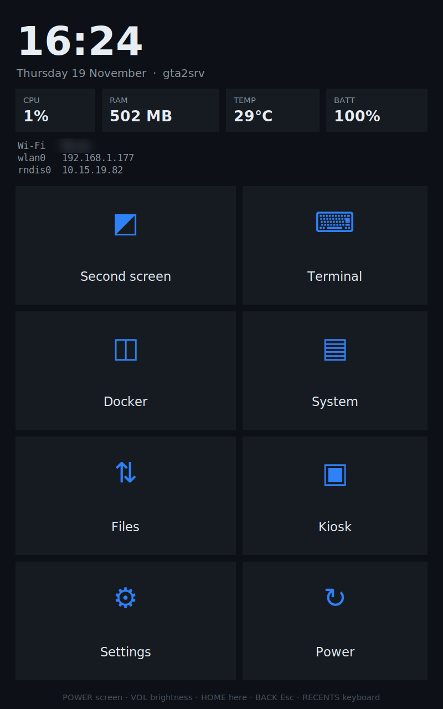
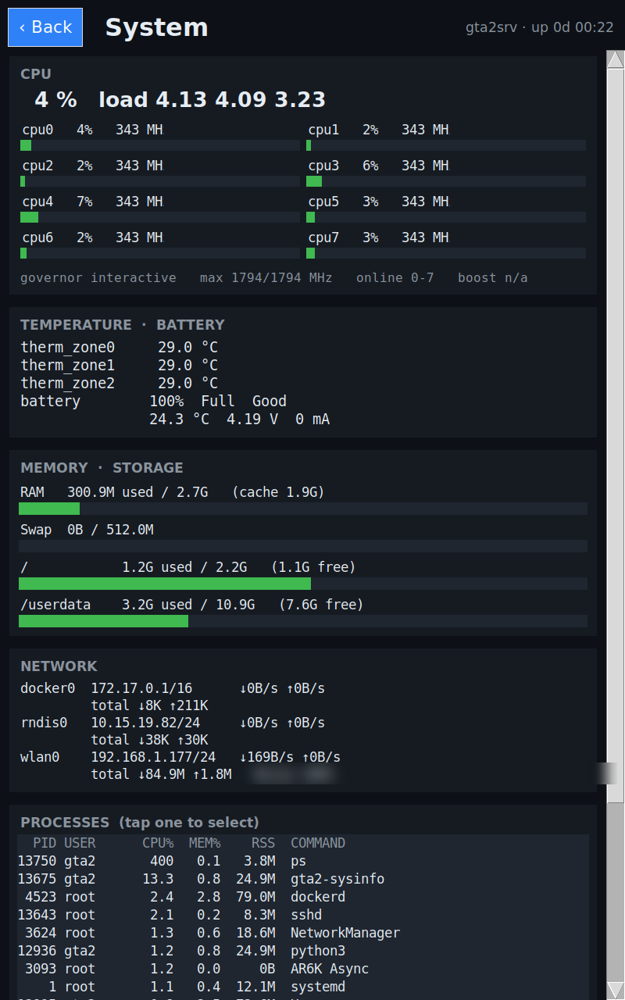
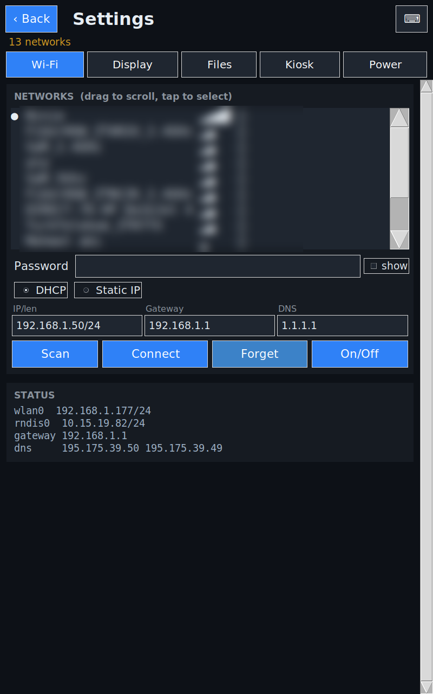
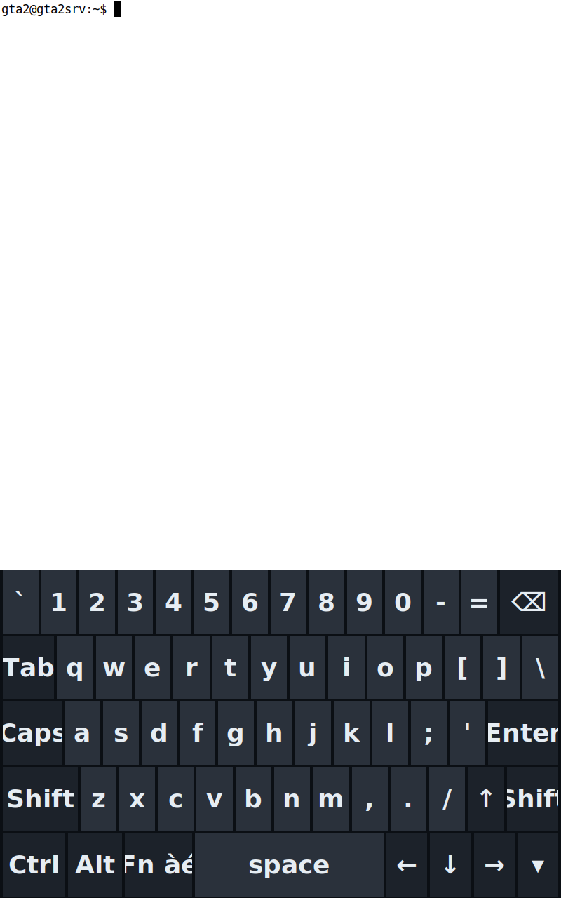
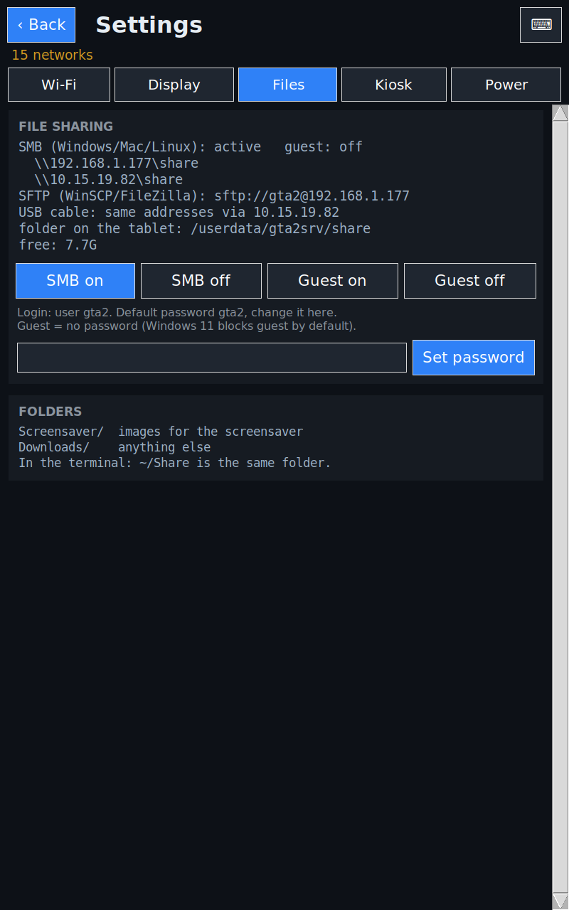
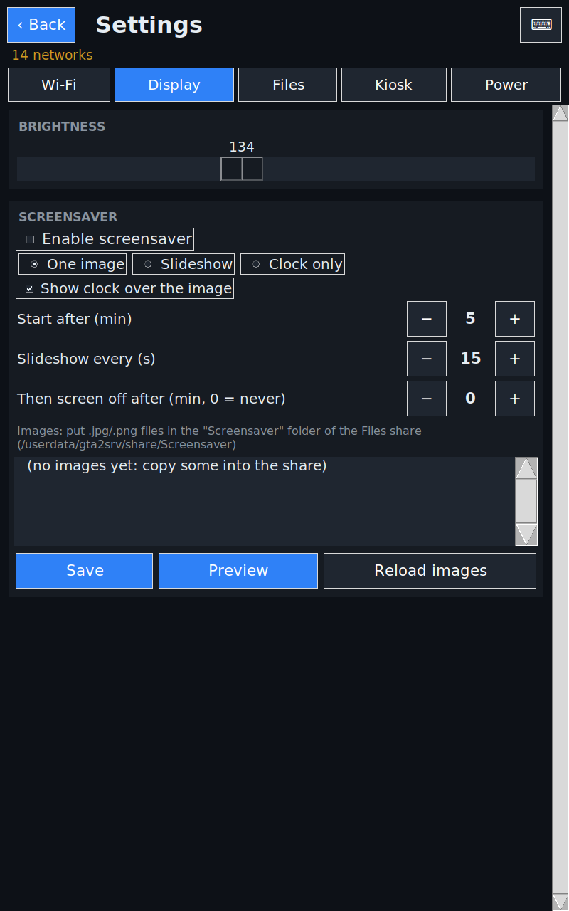
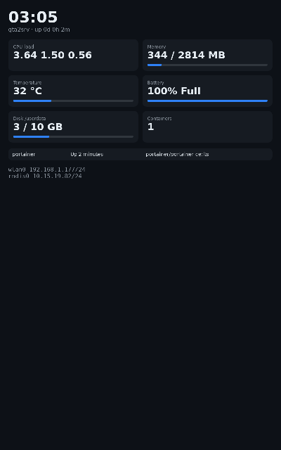

# Ubuntu for the Galaxy Tab Active2 LTE (SM-T395, Exynos 7870)

Two Ubuntu 24.04 builds for the rugged Samsung Galaxy Tab Active2 LTE (`gtactive2lte`):

| | **Ubuntu Server Mini** (recommended) | **Ubuntu Touch** (alpha) |
|---|---|---|
| What it is | Bare-bones Ubuntu 24.04 server with a tiny touch launcher | Full phone/tablet shell (Lomiri) on Halium 13 |
| Android inside | **No.** Native Linux, Android is not running | Yes, an Android 13 container for the hardware |
| RAM used after boot | **~300 MB** with the home screen + file sharing | ~1.3 GB |
| Boot time | **~15 s** | ~25 s |
| Use it for | Docker host, SSH box, second screen for a laptop | Touch tablet, calls/SMS, apps |
| Folder | [`server-mini/`](server-mini/README.md) | [`ubuntu-touch/`](ubuntu-touch/README.md) |

> Looking for Android? See **[LineageOS 20 (Android 13) OC edition](https://github.com/ttabouch12/LineageOS-20-Galaxy-Tab-Active2-SM-T395)**.
> That is also the way back to Android from either build here.

---

## Ubuntu Server Mini

A "server distro" for the tablet: native Ubuntu 24.04 (arm64), **no Android underneath**, about
**300 MB RAM** with the touch home screen and file sharing running and a **15 s boot**.

| Home | System monitor | Wi-Fi | Keyboard |
|---|---|---|---|
|  |  |  |  |

| File sharing | Screensaver settings | Screensaver | Kiosk / dashboard |
|---|---|---|---|
|  |  |  |  |

### What you can do with it

* **Docker host**: run light services (Pi-hole, Home Assistant, Uptime Kuma, Nginx, MQTT, Syncthing, small databases...).
  Manage them from the **Portainer** web UI (`https://<ip>:9443`) or over SSH. CPU and RAM limits work (`--cpus`, `-m`).
* **Always-on SSH box** over Wi-Fi or the USB cable (USB networking with DHCP for the laptop, `10.15.19.82`).
* **File sharing (NAS)**: an SMB share (`\\<ip>\share`, Windows/Mac/Linux, shows up in the Windows *Network* folder)
  and SFTP, over Wi-Fi **or the USB cable** (~27 MB/s over USB). User `gta2`, password `gta2` (change it in Settings > Files).
  The share lives in `/data/gta2srv/share`, so it survives reinstalling the OS.
* **Wall / desk monitor (kiosk mode)**: show any web page full screen with no login (a Pi-hole or Grafana dashboard,
  a status page). Built in: a live system dashboard on `http://<ip>:8088` (CPU, RAM, temperature, battery, disk,
  containers), also reachable from any browser on your network.
* **Second screen for a laptop**: Moonlight client, paired with Sunshine on the laptop (see `server-mini/SECOND-SCREEN.md`).
* **Rugged mini server**: the Tab Active2 is IP68, has a big battery as a built-in UPS, and runs on USB power.

### Home screen and keys

Eight tiles: **Second screen, Terminal, Docker** (Portainer full screen), **System** (htop-style monitor: per-core load
and clock, temperatures, RAM/zram, storage, network speed, battery, top processes with kill, Docker containers),
**Files** (sharing), **Kiosk, Settings, Power**. Tap the CPU/RAM/TEMP/BATT cards to open the System monitor.

The on-screen keyboard (`gta2-osk`) has big keys and a full PC layout: number row, Tab, Caps, Shift (tap = one
letter, double tap = lock), Ctrl and Alt (sticky for the next key), arrows, and an **Fn àé** layer with accents,
F1-F12, Esc, Del, Home/End/PgUp/PgDn. It never steals the focus, so it types into the app below. It opens with the
Terminal, when you tap a text field, or with Recents; the ▾ key hides it. Size Small/Medium/Large in Settings > Display.

**Screensaver**: your own image, a slideshow of a folder, or a moving clock, after 1-120 min of no touch, optionally
turning the screen off later. Copy pictures into the `Screensaver` folder of the share.

| Key | Action |
|---|---|
| Power | screen off / on (backlight) |
| Volume up / down | brightness |
| Home | back to the home screen |
| Back | Esc |
| Recents | on-screen keyboard on / off |

**Settings** (tabs, drag with a finger to scroll): **Wi-Fi** (scan / connect / forget, DHCP or static IP),
**Display** (brightness, screensaver), **Files** (SMB on/off, guest access, password, addresses), **Kiosk** (page +
"start at boot") and **Power** (Reboot, Shut down, TWRP recovery, Download mode).

**CPU**: all 8 cores at 1.79 GHz all the time; throttling starts at **90 °C** (92/94/96/98 °C steps, hardware
shutdown at 115 °C). Samsung's default started throttling at 76 °C.

### Install (about 5 minutes)

You need **TWRP** and the **LineageOS 20 OC ROM installed once** (linked above). Ubuntu Server Mini
reads the Wi-Fi firmware from that ROM's vendor partition, so flash LineageOS first if the tablet still
runs stock Samsung firmware.

1. Download the latest `ubuntu-server-mini-*.zip` from the [Releases](../../releases).
2. Boot TWRP (power off, then hold **Power + Volume Up**).
3. **Wipe > Format Data** and type `yes`. This erases the tablet, back up first.
4. Copy the zip to the tablet (`adb push`, MTP or a microSD card) and **Install** it.
5. **Reboot > System**. The home screen appears after about 20 seconds.

Default login: user **`gta2`**, password **`gta2`**. Change it right away with `passwd`.
Headless setup (SSH key and Wi-Fi without touching the screen): see `server-mini/README.md`.

### Limitations

* **Kernel 3.18** (Samsung/LineageOS): no user namespaces (no rootless containers, no userns-remap), Docker uses
  the slow `vfs` storage driver (images take their full size on disk), cgroup v1 only.
* **No GPU acceleration** (the Mali GPU needs Android). The screen is a plain framebuffer: fine for the home screen,
  terminal and dashboards, but browsers are slow and Moonlight decodes video on the CPU (30-60 fps, not for gaming).
* **Not supported**: sound, camera, Bluetooth, mobile data/SMS, GPS, fingerprint, NFC, auto-rotation, S Pen pressure.
  The camera device is locked to root because probing it crashes this kernel.
* **No virtual machines** (no KVM: the CPU's hypervisor mode is taken by Samsung's firmware).
* Screen off = backlight off (the display controller is not powered down; powering it down without Android is unstable).
* The kiosk browser (WebKit) runs without its sandbox (needs user namespaces): only show pages you trust. It uses ~100 MB RAM while open.
* Docker images must be `arm64` / `linux/arm64/v8`.
* Second screen pairing with Sunshine is not tested end to end yet.
* **No MTP** on this kernel (Samsung's USB gadget does not start a FunctionFS MTP function without Android): use the SMB
  share or SFTP over the USB cable instead, it is faster anyway.
* The Docker tile opens Portainer in WebKit (~150 MB RAM while open, HOME closes it).

### Back to Android

TWRP > Wipe > Format Data > flash the LineageOS 20 OC zip > Reboot. That's all.
Ubuntu Server Mini only uses the BOOT partition and files in `/data`.

---

## Ubuntu Touch (alpha)

Lomiri on Halium 13, with Wi-Fi, LTE/SIM, Bluetooth, stereo speakers, mic, sensors and USB networking.
Install steps, status and the porting notes are in [`ubuntu-touch/README.md`](ubuntu-touch/README.md).

---

## Credits

* LineageOS samsungexynos7870 kernel/device trees, Halium, UBports, Ubuntu, Docker, Portainer,
  Moonlight / Sunshine (LizardByte), matchbox.
* Port and tooling: ttabouch12.

No Samsung firmware or proprietary blobs are in this repo. Wi-Fi firmware is read from the
tablet's own vendor partition at runtime.
