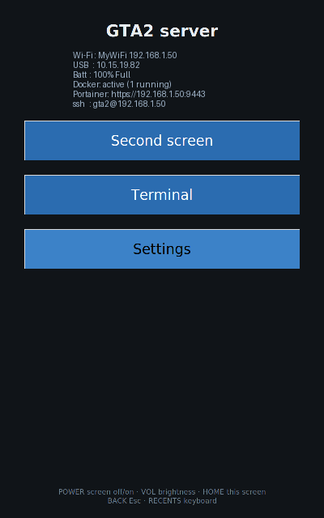

# Ubuntu for the Galaxy Tab Active2 LTE (SM-T395, Exynos 7870)

Two Ubuntu 24.04 builds for the rugged Samsung Galaxy Tab Active2 LTE (`gtactive2lte`):

| | **Ubuntu Server Mini** (recommended) | **Ubuntu Touch** (alpha) |
|---|---|---|
| What it is | Bare-bones Ubuntu 24.04 server with a tiny touch launcher | Full phone/tablet shell (Lomiri) on Halium 13 |
| Android inside | **No.** Native Linux, Android is not running | Yes, an Android 13 container for the hardware |
| RAM used after boot | **~240 MB** (~280 MB with Portainer) | ~1.3 GB |
| Boot time | **12-19 s** | ~25 s |
| Use it for | Docker host, SSH box, second screen for a laptop | Touch tablet, calls/SMS, apps |
| Folder | [`server-mini/`](server-mini/README.md) | [`ubuntu-touch/`](ubuntu-touch/README.md) |

> Looking for Android? See **[LineageOS 20 (Android 13) OC edition](https://github.com/ttabouch12/LineageOS-20-Galaxy-Tab-Active2-SM-T395)**.
> That is also the way back to Android from either build here.

---

## Ubuntu Server Mini

A "server distro" for the tablet. Everything that is not needed for a small always-on box is gone:
no Android, no lock screen, no sound, camera, Bluetooth or modem. What is left:

* **SSH** (`gta2@<ip>`, over Wi-Fi or over the USB cable)
* **Docker** + **Portainer** web UI on `https://<ip>:9443` (installed automatically on the first boot with internet)
* **Wi-Fi** with a touch settings app (scan, connect, forget, DHCP or static IP)
* **Terminal** with an on-screen keyboard
* **Second screen** for a laptop: Moonlight client, pairs with Sunshine on Windows/Linux/macOS
* Power key turns the screen off/on, volume keys set the brightness

### Install (about 5 minutes)

You need **TWRP** and the **LineageOS 20 OC ROM installed once** (linked above). Ubuntu Server Mini
reads the Wi-Fi firmware from that ROM's vendor partition, so flash LineageOS first if the tablet still
runs stock Samsung firmware.

1. Download the latest `ubuntu-server-mini-*.zip` from the [Releases](../../releases).
2. Boot TWRP (power off, then hold **Power + Volume Up**).
3. **Wipe > Format Data** and type `yes`. This erases the tablet, back up first.
4. Copy the zip to the tablet (`adb push`, MTP or a microSD card) and **Install** it.
5. **Reboot > System**. The launcher appears after about 20 seconds (boot measured at 12-19 s).

Default login: user **`gta2`**, password **`gta2`**. Change it right away with `passwd`.

### First steps

* **Wi-Fi:** Settings > Scan > pick the network > type the password (the keyboard opens on tap) > Connect.
* **SSH:** the launcher shows the IP. `ssh gta2@<ip>`.
  Over USB, the tablet is `10.15.19.82` and gives the laptop an address by DHCP (Windows has the RNDIS driver built in).
* **Docker:** `docker run -d --restart=always -p 8080:80 nginx:alpine`, or use Portainer.
  Open Portainer within 5 minutes of the first start to create the admin account
  (otherwise `docker restart portainer`).
* **Second screen:** see [server-mini/SECOND-SCREEN.md](server-mini/SECOND-SCREEN.md).

### Keys

| Key | Action |
|---|---|
| Power (short) | screen off / on |
| Power (long) | shut down |
| Volume up / down | brightness |
| Home | back to the launcher |
| Back | Esc |
| Recents | on-screen keyboard on / off |

### Back to Android

TWRP > Wipe > Format Data > flash the LineageOS 20 OC zip > Reboot. That's all, nothing else is changed.
(Both Ubuntu builds only use the BOOT partition and files in `/data`.)

---

## Ubuntu Touch (alpha)

Lomiri on Halium 13, with Wi-Fi, LTE/SIM, Bluetooth, stereo speakers, mic, sensors and USB networking.
Install steps, status and the porting notes are in [`ubuntu-touch/README.md`](ubuntu-touch/README.md).

---

## Credits

* LineageOS samsungexynos7870 kernel/device trees, Halium, UBports, Ubuntu, Docker, Portainer,
  Moonlight / Sunshine (LizardByte), matchbox.
* Port and tooling: ttabouch12.

No Samsung firmware or proprietary blobs are in this repo. Wi-Fi firmware is read from the
tablet's own vendor partition at runtime.
