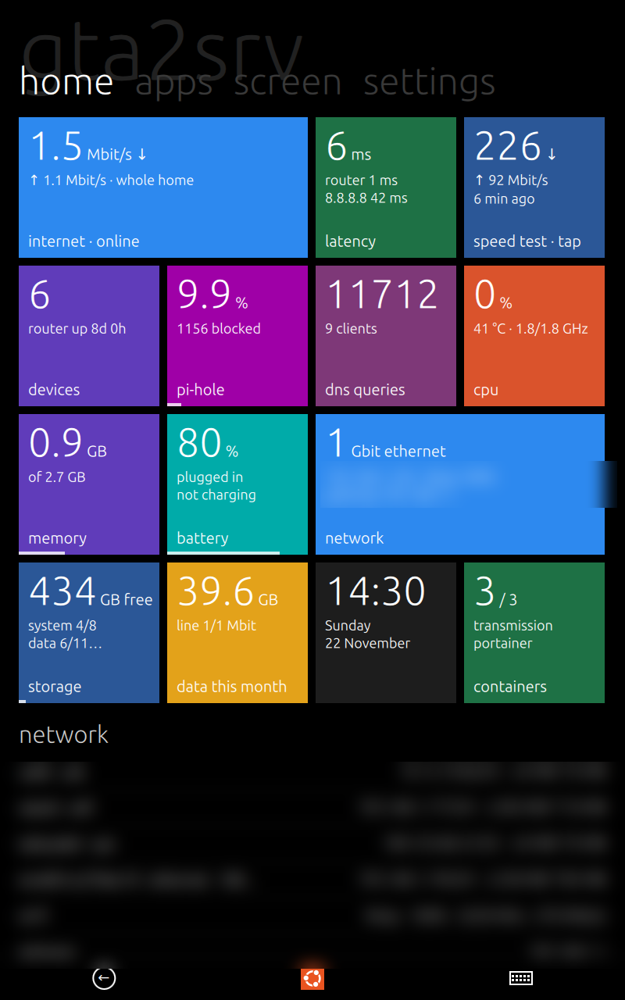
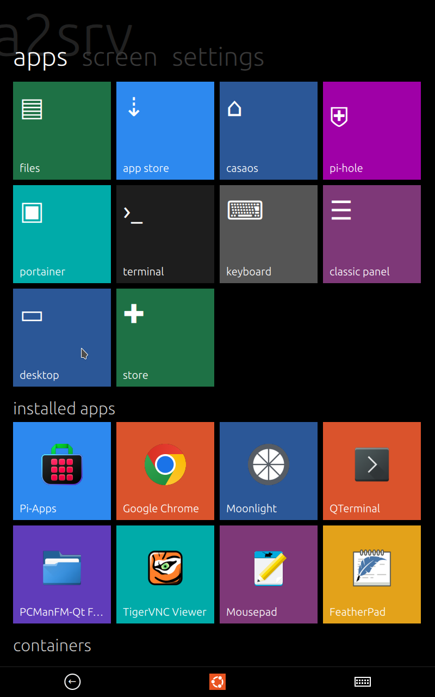
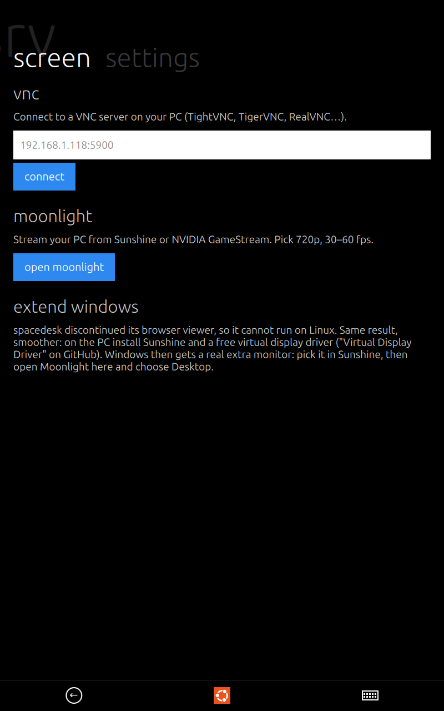
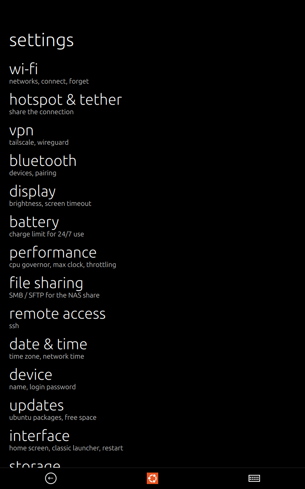

# Ubuntu Server Mini for Galaxy Tab Active2 LTE (SM-T395)

Native Ubuntu 24.04 LTS (arm64), **no Android underneath**, built to turn the tablet into a small
always-on server with a touch screen. Install and first steps are in the [main README](../README.md).

## Metro home, desktop mode and hardware video, 2026-11-22

| Home | Apps | Second screen | Settings |
|---|---|---|---|
|  |  |  |  |

* **Real 60 Hz:** the panel was running at 30 Hz. `exynos7_drm_decon` rounded its clock divider up
  (69 MHz vs 68.43 MHz pixel clock, divider 2). `gta2-60hz` writes divider 1 at session start and after every
  screen-on; the proper kernel fix is patch [0033](mainline/patches/0033-drm-exynos7-decon-closest-clkdiv-60hz.patch).
* **Native Metro home (Qt Quick, `gta2-home`):** Windows Phone 7/8 style panorama (home · apps · screen · settings),
  live tiles with smooth colour/number transitions, a detail page behind every tile, turnstile animations and the
  app-launch flip, on-screen back / home / keyboard bar (`gta2-navbar`). Holds 60 fps; the WebKit page
  (`usr/share/gta2/home`) stays as a fallback (`~/.config/gta2/webhome`). Everything runs through the same
  local API (`gta2-dash` on :8088, `/api`, `/live`, `/detail`, `/ctl` - write actions only from the tablet itself).
* **Settings ported to the home:** Wi-Fi, hotspot/tether, VPN, Bluetooth, display (brightness, screen timeout,
  navbar), battery limit, performance, file sharing, SSH, date & time, device, updates, storage, interface, power, about.
* **Desktop mode (USB-C dock):** LXQt with the KDE Breeze look, landscape, mouse cursor; `gta2-desktop on|off` or the
  *desktop* tile. The 7870 has no DisplayPort alt-mode, so it uses the tablet's own screen.
* **App store:** [Pi-Apps](https://github.com/Botspot/pi-apps) via `gta2-piapps` (Pi-Apps detects the CPU from
  `/sbin/init`, which is a script here; the wrapper binds a real arm64 binary over it in a private mount namespace,
  Pi-Apps itself stays unmodified). Installed apps show up as tiles with their icons; long-press to pin, uninstall
  or move single-folder apps to the external drive. CasaOS stays the store for Docker apps.
* **Hardware video decode (MFC):** H.264 through the Samsung MFC with mainline `s5p-mfc`
  (patches [0034](mainline/patches/0034-media-s5p-mfc-exynos7870-v10-iova-window-dec-opts.patch) +
  [0035](mainline/patches/0035-arm64-dts-exynos7870-gtactive2lte-safe5g-mfc-variant.patch)). The 7870's MFC only
  reaches buffers within 256 MB above its firmware, so the driver now places the firmware at the bottom of the
  IOVA space and keeps every buffer in that window. 1080p30 playback: ~6 % of one core vs ~57 % in software.
  `ffmpeg -c:v h264_v4l2m2m`, Moonlight (V4L2 M2M), Firefox with `media.hardware-video-decoding.force-enabled`.
  The firmware is Samsung's `mfc_fw.bin` from your own tablet's vendor partition, copied to
  `/lib/firmware/s5p-mfc-v10.fw`; it is not included here.
* **GPU:** Mali-T830 (panfrost) locked at 676 MHz by `80-gta2-gpu.rules` - retuning the clock under load caused GPU faults.
  WebKit's GPU path tops out at 15-30 fps on this chip; Qt Quick renders a frame in under 8 ms.
* **Boot splash:** Plymouth theme `gta2` (title + Windows Phone loading dots), quiet kernel and systemd output.
  U-Boot's own text remains (silent U-Boot is prepared in `build/docker/ub.sh`, untested).
* **Moonlight:** the *moonlight* button starts `moonlight-qt` (EGL). spacedesk's browser viewer was discontinued; for
  an extended Windows screen use Sunshine + a virtual display driver on the PC and Moonlight on the tablet.
* **External drive:** CasaOS app data can live on the USB drive (`/DATA/AppData` link) while Pi-hole and Portainer
  stay on the tablet.

## Mainline (6.18) additions, 2026-11

See [`MAINLINE.md`](MAINLINE.md) for the kernel side (DRM display, GPU, USB-C host, eMMC DDR52, r7).

* **USB-C docks:** Ethernet, USB ports and USB storage through a USB-C dock (tested: HyperDrive Next HD4003GL,
  RTL8153 gigabit). With a PD charger in the dock the tablet charges and stays host. USB 2.0 only, no HDMI.
* **Dashboard** (`gta2-dash`, port 8088): system, containers, disks incl. SD card, Pi-hole stats (% blocked,
  queries, blocked), network traffic, latency, outages and speed test from `gta2-netmon`; your own wallpaper from
  `/data/gta2srv/share/wallpaper.jpg|png|webp`.
* **Internet monitor** (`gta2-netmon.service`): pings the router, 1.1.1.1 and 8.8.8.8 every 10 s, logs outages,
  hourly Cloudflare speed test only while Ethernet is up (heavy load can crash the QCA9377 Wi-Fi firmware).
* **SD card:** shared over Samba as `\\<ip>\sdcard` (`gta2-share`); `gta2-sdformat` formats it ext4;
  `gta2-docker-sd` moves Docker's data onto the card (`docker.service` waits for it, `gta2-sdwait.conf`).
* **Tailscale** (native package): `sudo tailscale up --advertise-exit-node --advertise-routes=<lan>/24`;
  IP forwarding in `91-gta2-tailscale.conf`.
* **Router stats** (Zyxel EX3501-T1, `gta2-router`): whole-home WAN traffic, data used, line rate, devices online on both dashboards; see [`ROUTER.md`](ROUTER.md).
* **Display check** (`gta2-dsicheck`): reboots once if the panel link (DSI) came up dead at boot.
* **Battery limit for 24/7 use:** Settings or `/etc/gta2/charge_limit` (e.g. 80: stop at 80 %, resume at 75 %; 100 = off).

## 1.3 changes

* **New interface.** The look is shared from `gta2ui.py`: anti-aliased rounded cards, switches, steppers, segmented
  choices and a touch slider, all drawn with PIL in Tk. The home screen has the popcorn logo, a clock, chips and 4
  live stat cards.
* **Keyboard rewritten Gboard-style** (`gta2-osk`): one canvas, a toolbar (Esc/Tab/Ctrl/Alt/arrows/hide), a number
  row, the `abc` / `?123` / `=\<` layers, long-press accent popups, key-repeat backspace, one-shot Shift or Caps
  lock, and S/M/L sizes.
* **Settings v2** (`gta2-settings`): a category list, then a page per category. Root actions go through one helper,
  `gta2-ctl` (time, device, updates, CPU, screen, Bluetooth, battery, Docker, SSH, VPN, hotspot), which the web
  panel uses too.
* **Web panel** on port 80 (`gta2-panel`, socket-activated, exits when idle): stats, Docker apps, an app store,
  files, a live screen you can tap, and all settings. See [PANEL.md](PANEL.md).
* **Charge limit** (`gta2-charge`): stops charging at N % and resumes at N-5 %. It uses `charge_behaviour` on
  mainline, and Samsung's `batt_slate_mode` on 3.18 where that switch exists.
* **Rotation:** Settings → Display offers portrait / upside-down / landscape / landscape-flipped. It changes the
  Xorg `Rotate` option and `gta2-session` maps touch to match.
* **Screen timeout** (backlight off when idle, the power key wakes it).
* **microSD automount** (`gta2-sd` + udev): `/media/sdcard`, linked into the share as `SD card`.
* **Bluetooth** (BlueZ) page: power, scan, pair, remove.
* **CPU page:** the speed cap (Saver / Stock / 1.7 / 1.8 GHz) and the throttle temperature. `gta2-thermal` reads
  `/etc/gta2/maxfreq` and `/etc/gta2/throttle`.
* **Mainline 6.18 kernel (experimental):** CPU frequency scaling, TMU, charger switch and a one-shot safe test boot.
  See [MAINLINE.md](MAINLINE.md).

## 1.2 changes

* **Kernel `boot_srv5`:** CPU thermal throttling starts at **90 °C** instead of 76 °C (the trip points come from
  Samsung's ECT firmware table, the device tree values are ignored, so `exynos_tmu.c` is patched after the ECT is read).
  `gta2-thermal.service` keeps all cores at the top clock and steps down from 90 °C as a second safety net.
* **New on-screen keyboard** `gta2-osk` (Tk + xdotool, big keys, S/M/L): full PC layout with an Fn/accents layer,
  never takes the focus (ICCCM input hint off), a held finger types one key. `matchbox-keyboard` in `/usr/local/bin`
  starts it, so every existing toggle keeps working (`GTA2_OSK=matchbox` for the old one).
* **Home key fixed** (`pkill -f` matched its own shell), it also hides the keyboard and closes Portainer.
* **Charger-mode boots:** S-Boot starts the OS with `androidboot.mode=charger` after a shutdown with the cable in,
  and Samsung's touch and pen drivers refuse to load then. `gta2-lpm` reboots into a normal boot, unless the user
  chose Shut down (then: dark screen, off when unplugged, POWER = start).
* **Touch:** identity calibration matrix (Xorg `Rotate UD` already maps the digitizer).
* **Settings rewritten:** tabs, finger scrolling everywhere (the Wi-Fi list scrolls now), screensaver, file sharing.
* **System monitor** (`gta2-sysinfo`), **Docker tile = Portainer full screen** (`gta2-docker`, restarts Portainer
  if its 5-minute first-setup window expired).
* **Screensaver** (image, slideshow, clock) in the launcher, idle time taken from the touch screen and keys.
* **File sharing:** Samba share `\\<ip>\share` + WS-Discovery (`gta2-share`, `gta2-wsdd.service`), folder
  `/data/gta2srv/share` (kept across reinstalls), also `~/Share`.
* Image build: overlay files are made world-readable (Windows checkouts had them `0700`).

## 1.1 changes

* **Display:** Xorg blanks/unblanks fb0 when it starts, after which the DECON only scans out again after a fresh
  `FBIOPUT_VSCREENINFO` + `FBIOPAN_DISPLAY`; the session runs `gta2-fbinit --wake` right after X is up.
  Screen off/on is done with the backlight only.
* **Colours:** the DECON window format is R,G,B,X in memory; the kernel now reports red@0 / blue@16 (it reported
  XRGB, so red and blue were swapped).
* **Touch:** 180° libinput calibration matrix (Xorg `Rotate UD` does not turn absolute input devices).
* **Stability:** `/dev/video*` is root-only and the GStreamer v4l2 plugin is diverted: probing the Exynos camera
  (fimc-is) nodes panics this kernel (`v4l_id`, `gst-plugin-scanner`).
* **New home screen** (clock, live CPU/RAM/temperature/battery, tiles) that also owns the hardware keys (one process).
* **Kiosk mode** (`gta2-kiosk`, surf/WebKit) and a **status dashboard** on `:8088` (socket-activated, 0 MB when idle).
* **Power menu** with TWRP and Download mode: `gta2-reboot recovery|download` issues `reboot(RESTART2, "recovery")`
  directly (systemd does not pass the argument through on this kernel).
* **Full on-screen keyboard** layout (numbers, symbols, accented letters: hold **àé**).
* Image and kernel are now built with **Docker on any PC** (`build/docker/`): the kernel from LineageOS 22.2
  exynos7870 + the OC patch + the Ubuntu Touch patch + the colour fix, the rootfs in an `arm64` ubuntu:24.04 container.

## What's in it

| Part | How |
|---|---|
| Kernel | LineageOS samsungexynos7870 3.18.140 (same tree as the OC ROM, OC to 1.79 GHz), Halium config + Docker options |
| Boot | `boot.img` with a Halium initramfs + a small hook: if `/data/gta2srv/enabled` exists it loop-mounts `/data/gta2srv/rootfs.img` as `/` |
| Init | systemd 255, cgroup v1 (see below) |
| Display | plain fbdev on the Exynos DECON (`/dev/fb0`, 800x1280), Xorg `fbdev` + shadowfb, rotated 180° (panel is mounted upside down) |
| UI | matchbox WM (one fullscreen app at a time), Tk launcher / settings / second-screen apps, xterm, matchbox-keyboard |
| Network | NetworkManager + wpa_supplicant (QCA9377, qcacld driver, firmware from the vendor partition), USB RNDIS gadget with DHCP for the laptop |
| Server | OpenSSH, Docker 29 (`vfs` storage, data in `/data/gta2srv/docker`), Portainer CE |
| Second screen | moonlight-embedded (SDL, software H.264 decode) |
| Files | Samba (SMB2/3) share + wsdd, SFTP via OpenSSH |
| Memory | 512 MB zram swap, volatile journal (32 MB) |
| CPU | all 8 cores kept online at the OC max 1.79 GHz (`gta2-cpu.service`, `gta2-thermal.service`); throttling from 90 °C. Idle cores still use cpuidle. |

Measured on the tablet: **~240 MB RAM used** with the launcher on screen (Ubuntu Touch: 1.33 GB),
~280 MB with Portainer running, 830 MB on disk, boot 12-19 s (systemd-analyze), Docker containers start in ~1 s.
Tested as a clean install from the TWRP zip: SSH key + Wi-Fi import, Docker (bridge network, port publishing, `-m`/`--cpus` limits), Portainer, launcher, NTP.

## Removed on purpose

Android container and all HALs, Lomiri/Mir, PulseAudio, Bluetooth stack, oFono/modem, camera,
sensors, GPS, avahi, snapd, apt timers, docs/man pages/locales.

## How the hard parts were solved

1. **Display without Android.** The DECON fbdev driver only scans out after `FBIOPAN_DISPLAY`, and its
   bitfields are empty at boot. `gta2-fbinit` sets XRGB8888 and pans once; Xorg then draws normally.
   This only works because Android's hwcomposer never touches DECON here.
2. **Docker crashed the kernel.** `runc` + `CONFIG_USER_NS` hit a Samsung RKP/credential bug
   (`sget_userns` with a garbage user namespace). User namespaces are disabled in this kernel (Docker
   doesn't need them).
3. **Docker on the backported cgroup2** fails (`bpf_prog_query(BPF_CGROUP_DEVICE)`). The Samsung
   bootloader ignores the boot.img cmdline, so `/usr/sbin/init` is a tiny wrapper
   (`gta2-init`) that hands systemd `systemd.unified_cgroup_hierarchy=0` through
   `SYSTEMD_PROC_CMDLINE`. With cgroup v1, memory/CPU limits work (`docker run -m 64m --cpus 0.5`).
4. **Overlay storage**: 3.18 overlayfs has no multi-lowerdir and Docker 29 dropped
   fuse-overlayfs, so the `vfs` driver is used. Images take their full size on disk; fine for light services.
5. **Random kernel panics at boot**: udev's `v4l_id` probing the Exynos camera nodes. The rule is masked.

## Headless setup (no screen needed)

From TWRP (or any Linux reading the data partition), before the first boot:

```
/data/gta2srv/authorized_keys          -> appended to gta2's ~/.ssh/authorized_keys
/data/gta2srv/wifi/<name>.nmconnection -> NetworkManager keyfile, auto-connects
```

Example Wi-Fi keyfile:

```
[connection]
id=home
type=wifi
[wifi]
ssid=MyWiFi
[wifi-security]
key-mgmt=wpa-psk
psk=secretpassword
[ipv4]
method=auto
```

## Files on the tablet

| Path | |
|---|---|
| `/data/gta2srv/rootfs.img` | the whole OS (2.4 GB ext4 image, `/`) |
| `/data/gta2srv/enabled` | delete it to disable this OS (the boot image then falls back to Ubuntu Touch / Halium layout) |
| `/data/gta2srv/docker` | Docker images, containers and volumes |
| `/userdata` | the full data partition, mounted inside the OS |

## Known limits

* No GPU acceleration (Mali-T830 needs the Android blob), so Moonlight decodes on the CPU.
* Kernel 3.18: no user namespaces (rootless containers, userns-remap), no overlay2, no blkio throttling.
* No virtual machines (EL2 is taken by Samsung's hypervisor, no KVM in this kernel).
* Moonlight touch input and Sunshine pairing are not tested end to end yet (no Sunshine host during development).

## Build it yourself

On any Debian/Ubuntu x86_64 machine with `qemu-user-binfmt`:

```
sudo bash build/stage1_debootstrap.sh     # Ubuntu 24.04 arm64 minbase + packages
sudo bash build/stage2_configure.sh       # overlay/, user, services, moonlight-embedded, rootfs.img
sudo bash build/pack_twrp_zip.sh          # boot.img + rootfs.img.gz -> TWRP zip
```

Paths inside the scripts point at the author's build box (`/home/builder/srv`, `/root/upload`), adjust them.
The kernel is the [Ubuntu Touch kernel patch](../ubuntu-touch/) with `CONFIG_USER_NS` off and
`POSIX_MQUEUE`, `CFS_BANDWIDTH`, `DUMMY` on; the initramfs hook is in `build/initrd_gta2srv.patch`.

## Roadmap (v2)

* Docker Swarm cluster mode (several tablets / PCs, managed from Portainer)
* Mainline-based kernel (postmarketOS exynos7870 work) for overlay2, user namespaces, cgroup v2
* Trim the kernel (camera/modem/audio drivers) and reclaim the modem/GNSS reserved RAM (~150 MB)
